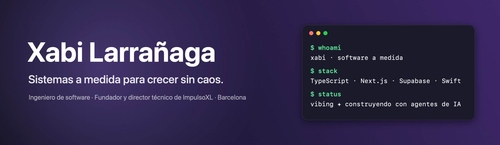

## 👋 Hola, soy Xabi

Ingeniero de software navarro, de Pamplona, y fundador y director técnico de **[ImpulsoXL](https://impulsoxl.com)**.

Ayudo a pequeñas empresas y equipos en crecimiento a pasar **del caos operativo a un sistema claro**: CRMs a medida para sectores concretos, paneles de control y automatizaciones que eliminan trabajo manual. Con IA, pero solo **cuando aporta valor real y medible**.

## 🧭 Cómo trabajo

| | |
|---|---|
| 🔍 **Primero, el diagnóstico** | Mapa de procesos y hoja de ruta: dónde se pierde información, tiempo y control. |
| 🛠️ **Después, el sistema** | Software a medida que tu equipo usa de verdad: CRM, app operativa, panel de control. |
| ⚙️ **Lo que se repite, automático** | Integraciones, flujos y APIs para que nadie copie datos a mano. |
| 🤖 **IA con criterio** | Donde ahorra horas o errores, nunca por ponerla. |

## 🚀 Proyectos

### ⏺️ [Minutes](https://github.com/xabilarra/minutes) · open source

App nativa para macOS que graba tus videollamadas **sin meter bots** en la reunión, las transcribe con Groq y te deja la transcripción lista para pasársela a tu agente de IA.

### 🏦 [NexoBrokers](https://nexobrokers.es)

Producto propio de ImpulsoXL: CRM hipotecario SaaS multi-tenant para brokers, con portal de clientes, firma digital y comparador bancario.

### 🏢 [ImpulsoXL](https://impulsoxl.com/casos)

Desarrollo de software a medida con propósito. Nueve proyectos entre trabajos para clientes y productos propios: clínicas, formación, fitness, logística urbana, restauración y finanzas.

## 🧰 Stack

  
  
  
  
  
  
  
  
  
  
  

**Arquitectura:** Clean, Hexagonal y Screaming Architecture · tests primero · entregas pequeñas y revisables. 
**En la terminal:** [herdr](https://github.com/herdrdev/herdr) · [Moshi](https://getmoshi.app) · [gentle-shell](https://github.com/Gentleman-Programming/gentle-shell).

## 🤖 Programo con agentes de IA

Trabajo con Claude Code y **[Gentle AI](https://github.com/Gentleman-Programming/gentle-ai)**: memoria persistente entre sesiones, Organic-Driven Development y revisión de código acotada antes de entregar. Minutes, por ejemplo, salió de ahí: diseñado, construido, revisado y probado con agentes.

## 🔭 Ahora mismo

- 🏦 Haciendo crecer NexoBrokers.
- ⏺️ Puliendo Minutes con uso real.
- 🧪 Llevando agentes de IA a procesos de negocio que funcionan a base de parches.

## 📬 ¿Hablamos?

Si tu operación va a base de Excels, parches y copiar y pegar, **[cuéntame tu caso](https://xabilarra.com/contacto)** o **[reserva 30 minutos](https://link.impulsoxl.com/widget/booking/25qJjY0PGQdrJM98ya9W)**.

   
  

